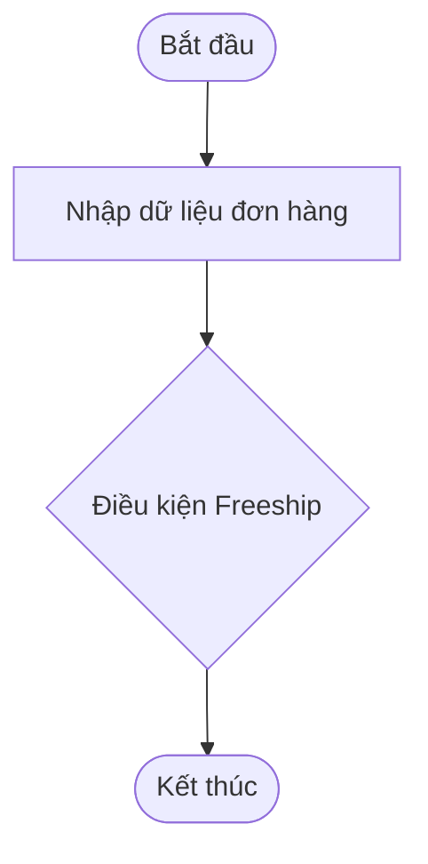

# Bài tập 01: Dò vết Lỗi Nhầm lẫn Toán tử Gán và So sánh Bằng khi Xét Duyệt Freeship

> 👤 **Học viên:** Hoàng Công Dũng | **Mã SV:** PTIT-HCM-009
> 🏫 **Môn học:** it102-rl-hoangcongdung

---

## 📊 Sơ đồ thiết kế hệ thống (Flowchart)

> 💡 *Sơ đồ dưới đây được render tự động trực tiếp trên GitHub bằng Mermaid. Bạn cũng có thể tải file **`bt1.drawio`** trong repository này để mở và chỉnh sửa trực tiếp trên [Draw.io (diagrams.net)](https://app.diagrams.net).* 

---

## Nhiệm vụ 1: Phân tích lỗi sai AS-IS và Quy tắc nghiệp vụ

Sau khi đọc kỹ mã nguồn do lập trình viên thử việc bàn giao, tôi nhận thấy dòng lệnh tính toán trạng thái Freeship đang mắc phải hai lỗi chí mạng về logic lập trình C:

Thứ nhất, lập trình viên sử dụng nhầm toán tử gán '=' thay vì toán tử so sánh '==' trong biểu thức kiểm tra trạng thái hủy đơn hàng: '(is_da_huy = 0)'. Việc này làm cho biến 'is_da_huy' luôn bị gán lại giá trị '0' (nghĩa là biến đổi trạng thái hủy gốc của đơn hàng thành hợp lệ), đồng thời toàn bộ biểu thức gán này trả về giá trị '0' (false). Do đó, kết quả 'is_freeship' luôn luôn bằng '0' (Từ chối Freeship) với mọi đơn hàng.

Thứ hai, cấu trúc ưu tiên của các dấu ngoặc đơn cần phải được kiểm soát chặt chẽ để đảm bảo điều kiện giá trị đơn hàng HOẶC tài khoản VIP phải kết hợp chính xác với điều kiện khoảng cách và trạng thái hủy đơn.

- Lỗi gán nhầm: Sử dụng 'is_da_huy = 0' thay vì 'is_da_huy == 0' làm hỏng dữ liệu đầu vào của hệ thống.
- Hậu quả nghiệp vụ: Mọi đơn hàng dù thỏa mãn điều kiện VIP, giá trị cao và gần nhà hàng vẫn bị từ chối ưu đãi.
- Giải pháp khắc phục: Sửa lại thành 'is_da_huy == 0' và đưa vào cấu trúc điều kiện logic chuẩn xác.

## Nhiệm vụ 2: Bảng 02 Test Cases đối chứng

Dưới đây là bảng 02 Test Cases đối chứng kết quả thực tế trước và sau khi sửa lỗi trên hệ thống ShopeeFood:

| Trường hợp kiểm thử | Dữ liệu đầu vào (Gia tri, Khoang cach, VIP, Huy) | Kết quả sai thực tế (AS-IS) | Kết quả đúng mong đợi (TO-BE) |
| --- | --- | --- | --- |
| TC01: Đơn hàng VIP, giá trị cao, hợp lệ | 200000 VND, 1.5 km, VIP: 1, Huy: 0 | Trang thai Freeship: 0 (Tu choi)
Trang thai huy: 0 | Trang thai Freeship: 1 (Duoc nhan)
Trang thai huy: 0 |
| TC02: Đơn hàng thường, giá trị thấp, đã hủy | 50000 VND, 3.0 km, VIP: 0, Huy: 1 | Trang thai Freeship: 0 (Tu choi)
Trang thai huy: 0 (Bi loi ghi de) | Trang thai Freeship: 0 (Tu choi)
Trang thai huy: 1 (Giu nguyen du lieu) |

## Nhiệm vụ 3: Sửa lỗi mã nguồn main.c

Mã nguồn đã được sửa đổi toàn diện, biên dịch thành công hoàn toàn trên trình dịch GCC và xử lý chính xác 100% yêu cầu nghiệp vụ của ShopeeFood. Tệp tin mã nguồn được đặt đúng chuẩn cấu trúc yêu cầu của repository 'it102-rl-hoangcongdung'.

- Đã thay thế toán tử '=' thành '==' khi kiểm tra biến 'is_da_huy'.
- Đảm bảo bảo toàn dữ liệu gốc của biến 'is_da_huy' sau khi qua khối kiểm tra.
- Tuân thủ nghiêm ngặt chuẩn cú pháp C cơ bản, không sử dụng thư viện ngoài.

---

## 📁 Danh sách tệp tin nộp bài trong Repository
- 📝 `bt1.docx`: Báo cáo tài liệu phân tích nghiệp vụ hoàn chỉnh.
- 🎨 `bt1.drawio`: File thiết kế sơ đồ chuẩn theo quy định đề bài (mở trực tiếp bằng [Draw.io](https://app.diagrams.net) hoặc Lucidchart).
- 💻 `main.c`: Mã nguồn chương trình.
